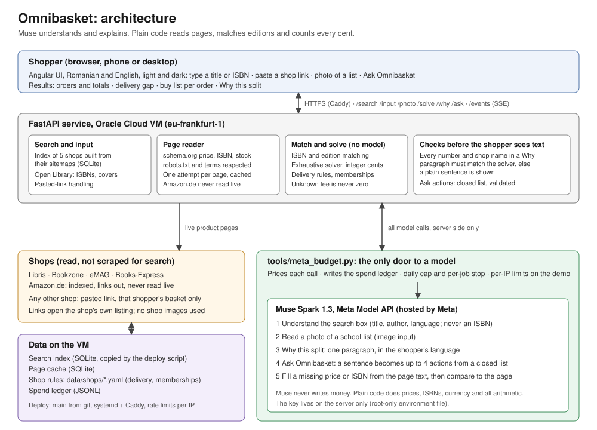

# Omnibasket

**One basket, every shop, lowest total.**

Splits a basket of books across independent Romanian online bookshops for the lowest real total,
including shipping and per-order fees. The pitch is a Romanian parent splitting a school reading
list across local shops. The United States is parked: only Amazon.com loaded cleanly from this
machine, and a Romanian egress distorts US prices.

- **Live:** https://omnibasket.anottersolution.com (Romanian and English, no sign-in)
- **Architecture:** [one-page diagram](docs/submission/architecture.svg)
- **Models:** Muse Spark 1.3 on Meta's Model API. See [Where Muse Spark runs](#where-muse-spark-runs).
- **Built during the hackathon:** the first commit is from 26 Oct 2026, 23:29 UTC; there is none before it.



Built for the [Meta Global AI Developer Hackathon](https://cerebralvalley.ai/e/meta-ai-developer-hackathon)
(indie developer track, theme: Build for Your World). Submission due 4 Nov 2026, 9:00 PM ET.

## The problem

A basket of several books across several stores means several free-shipping thresholds and a per-order fee.
The cheapest answer is not "buy each item where it is cheapest":

- Paying *more* for one item can cross a store's free-shipping threshold and win the basket.
- A per-order fee makes a tiny extra order a net loss.

Books are the launch wedge: a real basket, real ISBNs, and stores that publish their shipping rules.
Nothing in the design is book-specific — the same solve applies to any basket of goods with
per-store thresholds.

## How it works

1. **Read** — each shop's product page is read with plain code from its schema.org data: title, ISBN,
   price, currency and stock. Muse Spark fills in only a price or ISBN the page leaves out; Libris and
   Books-Express always print both, so live reads have not needed it since 30 Oct. The saved pages of the
   locked `ro-v1` basket each carry a Muse Spark read from the capture job.
2. **Match** — offers are matched by ISBN, with edition rules applied per book, and the app checks each
   Muse Spark read against the page it was read from. A read that disagrees is shown on the offer as a
   mismatch and never replaces the captured price. The edition pin lets you keep the same-story default
   or require the exact edition.
3. **Solve** — `POST /solve` computes assignments and delivery costs in integer cents. Unknown fees are not printed and are never treated as zero.
4. **Compare** — the UI presents the result as tabs: **1 order**, **Cheapest**, and **Custom**. When the cheapest split is itself one order, the first two are one tab ("1 order · cheapest"), so there are two tabs; when only one shop can price the basket, that shop is the only result. Cheapest assigns each book for the lowest valid basket total. In custom stores, every switched-on shop must take at least one book; books move among enabled shops in the cheapest way. If an enabled shop cannot be served, no custom total is shown.
5. **Inspect** — book details include links to the real shop offers, so you can open the underlying listing, and each offer says whether Muse Spark read it and whether the read matches the page.

### Where Muse Spark runs

Every model call is **Muse Spark 1.3 on Meta's Model API** (`muse-spark-1.3`), made from the server; the browser never
holds a key. Every call goes through `tools/meta_budget.py`, which prices it, records it in the spend ledger and stops at
the day cap. Plain code, never a model, does prices, ISBN checks, currency and all money arithmetic. `meta_budget.py` also
has a provider entry for an open-weight model on Baseten; no part of the app uses it today.

- **Understanding the search box**: free text in Romanian or English becomes a title, author and language to look up in our
  index. Muse never supplies an ISBN.
- **Why this split**: one short paragraph per result. Plain code checks every number and shop name in it, and the
  plain template sentence is shown instead when the check fails or Muse is unavailable.
- **Ask Omnibasket**: maps a typed sentence onto a few closed UI actions. It never writes text the shopper sees.
- **Photo of a reading list**: reads the titles in the photo.
- A pasted link is not read by Muse: one shop page is read with plain code, and links to other sites use the ISBN
  in the address.

## Front end

The responsive Angular UI shows the solve results as tabs: **1 order** (one shop for the whole basket), **Cheapest** (lowest basket total), and **Custom** (choose the shops allowed to participate). When the cheapest split is one order, those two share one tab, so there are two tabs. Custom-store assignments ensure each selected shop receives at least one book, then place books as cheaply as possible; if any selected shop has no usable offer, the UI withholds a total rather than implying it can fulfill the selection. Each book detail exposes real shop links. The edition pin controls whether matching accepts the same story or requires the exact ISBN; changing it reruns `/solve`. Books are added by title, author or ISBN search (our shop index plus Open Library), by a pasted shop link, or from a photo of a reading list.

## Stack

| Layer | What is built |
|---|---|
| Backend | Python, FastAPI. `POST /solve` and `GET /events` (server-sent events). The built UI is served from the same app. |
| Page reading | Cache-first. Saved pages live in a SQLite page cache. Live pages are read from schema.org; Muse Spark only fills a missing price or ISBN. The capture spike (Playwright) and the reader (`tools/muse_reads.py`) are separate from the demo path. |
| Read layer | `matching/` normalises ISBNs, keeps seller certainty tri-state, and matches editions instead of averaging them. |
| Solver | `solver/`: exhaustive assignment in integer cents. Tests in `solver/tests/`, including the Romanian basket. |
| Storage | SQLite page cache, seeded from the locked Romanian basket. |
| Front end | Angular and TypeScript in `ui/`, responsive. Declared memberships are one switch each under Options, shown only for a shop that can take a book. |
| Stores | Five indexed shops: Libris, Bookzone, eMAG, Books-Express and Amazon.de (Amazon.de is never read live). Any other shop works only by pasting a link, in that shopper's basket. |

## Run the demo

One command from a fresh clone. It creates a Python 3.12 virtualenv, installs the pinned
dependencies in `requirements.txt`, builds the Angular UI, seeds the SQLite page cache from
`data/cache/ro-v1-seed.json`, and serves the API and the built UI together.

You need [uv](https://docs.astral.sh/uv/) and Node.js (npm). No API key is required: the sample basket replays
the saved reads, and with no key nothing calls a model (the Why text falls back to the plain template sentence;
Ask Omnibasket and the photo reader need a key). Searching for or adding other books still reads Open Library and
the shops live, in demo mode too. The reads are re-run with a key, one Muse Spark
call per saved page, in replay mode:

```bash
META_API_KEY=<key> python3 tools/muse_reads.py
```

Every call is written to the spend ledger by `tools/meta_budget.py`, with a job stop short of USD 1.

```bash
./scripts/start-demo.sh --demo   # demo mode: serves the ro-v1 sample basket
./scripts/start-demo.sh          # normal mode: no sample data
```

Then open http://127.0.0.1:8000 . `GET /health` returns `{"status":"ok"}`.

### Demo mode vs normal mode

Demo mode is an explicit flag: `--demo` on `scripts/start-demo.sh`, which sets `OMNIBASKET_DEMO=1` (`1` or `true`) for the service. Without it the service runs in normal mode.

- `GET /config` returns `{"demo": bool, "commit": "<short sha>"}`. `demo` is true only when the env var says so.
- Demo only: `GET /sample` (the 'Try a sample basket' target), `POST /solve` with no basket body, and `GET /events?source=cache`. In normal mode all three return 404, so no captured data is served.
- The Mac LaunchAgent (`ai.omnibasket.app`) and the VM unit never pass `--demo` or set `OMNIBASKET_DEMO`.

## Status

A working app on a public URL. What is built:

- **One box**: type a title, author or ISBN (Romanian or English), paste a shop link, or photograph a reading list. Any
  book can go in the basket; the saved `ro-v1` basket is only the demo-mode sample and the test fixture.
- **Search** on our own index of five shops, built from their sitemaps, plus Open Library for ISBNs and covers. No shop
  search page is ever fetched; each product page gets one live read, Amazon.de none.
- **An exhaustive integer-cents solver** (`solver/`): one order, the cheapest split, or a set of shops you choose, with
  each shop's delivery fee, free-delivery threshold and per-order fee. Unknown fees are never priced as zero.
- **Read layer** (`matching/`): ISBN check digits, sold-by tri-state, and edition matching that does not average
  different books. Every Muse read is compared with its page; a disagreement is shown, never used.
- **Why this split, Ask Omnibasket, photo of a list**: Muse Spark, with every number and shop name checked in code.
- **Delivery gap, buy list per order, memberships** (`api/memberships.py`; Amazon Prime, eMAG Genius: a membership
  changes a total only when the shop's own rules page says so; today none does), a basket item with no offer named
  next to the orders.
- **Romanian and English**, light, dark and system theme.
- **Tests**: `pytest` 844 passed, 3 skipped; `ng test` 298; `ng build` green (1 Nov).

Bookzone under 200 lei is delivery from **10.90 lei** plus **1.99 lei** processing (cart at bookzone.ro/cos/produse).
Amazon.de free delivery to Romania starts at **262.17 lei** (printed on its product pages, read 28 Oct 2026; the lei
value moves with the exchange rate). The under-threshold Amazon.de amounts are unknown and are not priced.

Demo mode (`--demo`) replays the saved `ro-v1` basket: with it, the UI compares one order (**558.73 lei** via Libris),
cheapest (**515.16 lei**) and custom stores (**530.45 lei**). Every one of its 15 saved pages carries a Muse Spark 1.3
read, checked against the captured price: 15 match, 0 mismatch, USD 0.19 for the job.

## Next steps

Future work; none of it is built.

1. **Finding shops**: a web search for who else sells an ISBN and ships to Romania, so new shops come from search and
   not only from pasted links.
2. **Shops learned by Muse**: Muse checks a new shop's robots.txt and terms, finds its product sitemaps and reads its
   delivery page into a profile that a person confirms.
3. **Sanctioned data**: partner feeds and affiliate APIs in place of page reads where a shop offers them.
4. **Beyond books**: GTIN as the match key, like ISBN, for any basket from shops that publish thresholds.

## Novelty

No consumer tool found combines independent retailers with per-store free-shipping thresholds on one basket. The closest neighbours are single-marketplace cart
optimisers (Cardmarket, TCGplayer, Brick Owl), US-only extensions with no fee modelling (CartHappy),
single-store basket comparison (BasketWise, Australia), and single-item comparison (Meta Muse
shopping, Google Universal Cart). Full survey with sources: `docs/prior-work.xlsx`.

## Data note

`docs/ground-truth.xlsx` is hand-verified store data used as the extraction accuracy test and as
cached page fixtures for the recorded demo. It is **data collected for testing**, not application
code; all application code here was written during the hackathon window.

## Risks

- **Stores block agents.** Amazon blocked Meta Muse in September 2026 and its robots.txt names AI
  agents. Mitigation: the recorded demo runs against cached fixtures, with live reads where they
  succeed.
- **Membership badges hidden when logged out.** Mitigation: user-declared memberships plus each
  store's published rules.
- **Location-dependent shipping.** Mitigation: delivery address is a required input.

## Licence

MIT — see `LICENSE`.
