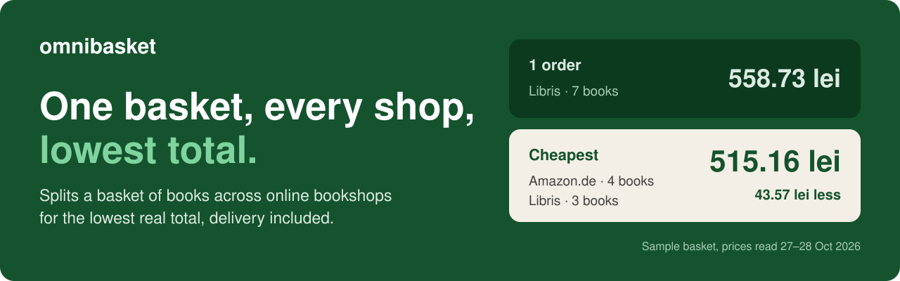
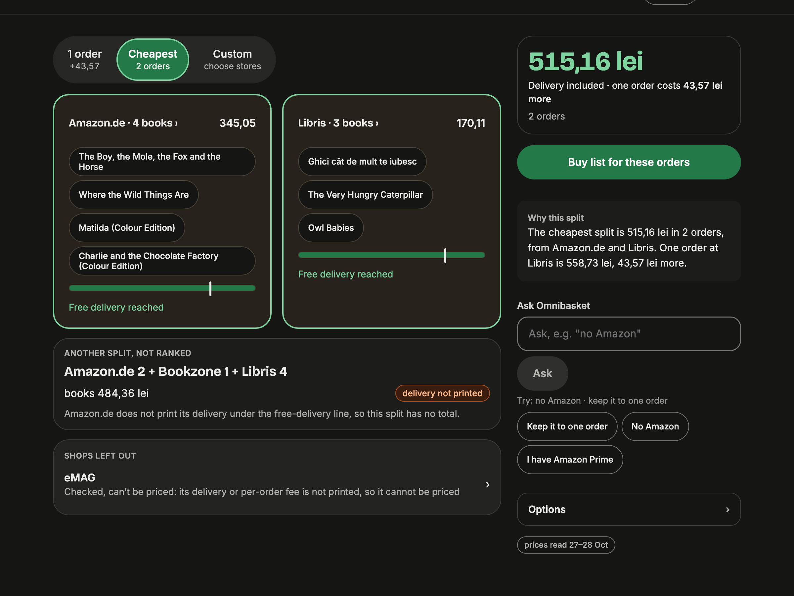

# Omnibasket



**One basket, every shop, lowest total.**

Splits a basket of books across independent Romanian online bookshops for the lowest real total, including shipping and
per-order fees. It is for people who buy several books at once: Omnibasket works out which books to buy at which shop,
and a school reading list is one such basket.

- **Live:** https://omnibasket.anottersolution.com (Romanian and English, no sign-in)
- **Demo video:** [under three minutes on YouTube](https://www.youtube.com/watch?v=ntrzr9c6UMI)
- **Architecture:** [one-page diagram](docs/submission/architecture.svg)
- **Models:** Muse Spark 1.3 on Meta's Model API, and Muse Spark Open, Meta's open-weights model, on Baseten. See
  [Where Muse Spark runs](#where-muse-spark-runs).
- **Built during the hackathon:** the first commit is from 26 Oct 2026, 23:29 UTC; there is none before it. The history
  was cleaned of internal notes and exploration files before release, with commit dates unchanged, so "PR" numbers in
  commit messages refer to the private repo.

Built for the [Meta Global AI Developer Hackathon](https://cerebralvalley.ai/e/meta-ai-developer-hackathon) (indie
developer track, theme: Build for Your World), and entered for Best Build on Meta Open Weight Models and Best Agentic
Use-Case.

## The problem

A basket of several books across several shops means several free-delivery thresholds and a per-order fee. The cheapest
answer is not "buy each book where it is cheapest". Seven children's books, priced on 27 and 28 Oct 2026, show why:



| Plan | Orders | Total |
|---|---|---:|
| **1 order** | Libris, 7 books, free delivery | 558.73 lei |
| **Cheapest** | Amazon.de, 4 books, 345.05 lei, free delivery · Libris, 3 books, 170.11 lei, free delivery | **515.16 lei** |
| **Custom:** all three shops must take a book | Amazon.de 345.05 lei · Libris 126.01 lei · Bookzone 59.39 lei | 530.45 lei |

- **Paying more for a book can win the basket.** *Matilda* and *Charlie and the Chocolate Factory* are 84.18 lei each at
  Libris and 94.33 lei at Amazon.de. The cheapest plan still buys them at Amazon.de: that extra 20.30 lei lifts the order
  over Amazon.de's 262.17 lei free-delivery line, and the other two books are 63.87 lei cheaper there. Below that line
  Amazon.de's delivery is not printed, so a smaller Amazon.de order gets no total and is shown unranked.
- **A cheaper book can cost more.** *Ghici cât de mult te iubesc* is 10.50 lei cheaper at Bookzone than at Libris. Moving
  it adds 12.89 lei of Bookzone delivery and fees, and drops Libris under its free-delivery line for another 12.90 lei.
  The basket ends up costing 15.29 lei more.

Books are the launch wedge: a real basket, real ISBNs, and shops that publish their delivery rules. Nothing in the design
is book-specific: the same solve applies to any basket of goods with per-shop thresholds.

## How it works

Books go in by title, author or ISBN search (our shop index plus Open Library), by a pasted shop link, or from a photo of
a list. Then:

1. **Read.** Each shop's product page is read with plain code from its schema.org data: title, ISBN, price, currency and
   stock. Muse Spark fills in only a price or ISBN the page leaves out; Libris always prints both, so its reads do not
   need it. Elefant pages have no schema.org data, so `api/elefant_page.py` reads them in plain code and they never go
   to Muse.
2. **Match.** Offers are matched by ISBN, with edition rules per book, and different editions are never averaged. The
   edition pin keeps the same-story default or requires the exact edition; changing it reruns `/solve`. Every Muse Spark
   read is checked against its page: one that disagrees is shown on the offer as a mismatch and never replaces the
   captured price.
3. **Solve.** `POST /solve` computes assignments and delivery costs in integer cents, exhaustively. An unknown fee is
   never printed and never treated as zero.
4. **Compare.** The UI shows **1 order**, **Cheapest** and **Custom** as tabs. When the cheapest split is itself one
   order, the first two share a tab. In Custom, every shop you switch on must take at least one book; if one cannot be
   served, no total is shown. Each result has a buy list per order and says how far a shop is from free delivery.
5. **Inspect.** Each book links to the real shop offers and says whether Muse Spark read the offer and whether the read
   matches the page.


A few rules hold throughout:

- Prices, ISBN checks, currency and all money arithmetic are plain code, never a model.
- Every number a model writes is checked against captured data before it is shown.
- A book that no shop we read has is named next to the orders, with why, instead of being dropped.
- robots.txt and shop terms are followed. No shop search page is ever fetched, and each product page gets one attempt.
- Book covers come from Open Library, never from shops.

<details><summary>Stack</summary>

| Layer | What is built |
|---|---|
| Backend | Python, FastAPI. `POST /solve` and `GET /events` (server-sent events). The built UI is served from the same app. |
| Search | Our own index of the shops, built from their sitemaps, plus Open Library for ISBNs and covers. When Open Library does not answer within 3 s, its earlier answers or the shop index answer instead, marked as shop listings. |
| Page reading | Cache-first. A SQLite page cache stores the facts read from a page (title, authors, ISBN, price, currency, availability and the numbers it printed); no page text is kept. |
| Read layer | `matching/` normalises ISBNs, keeps seller certainty tri-state, and matches editions instead of averaging them. |
| Solver | `solver/`: exhaustive assignment in integer cents. Tests in `solver/tests/`, including the Romanian basket. |
| Memberships | `api/memberships.py` (Amazon Prime, eMAG Genius): a membership changes a total only when the shop's own rules page says so; today none does. |
| Front end | Angular and TypeScript in `ui/`, responsive, Romanian and English, light, dark and system theme. |

</details>

## Where Muse Spark runs

Two Meta models, both called from the server; the browser never holds a key:

- **Muse Spark 1.3 on Meta's Model API** (`muse-spark-1.3`) writes the Why paragraph, reads photos and fills page gaps.
- **Muse Spark Open on Baseten** (`meta-models/muse-spark-open-1026`), Meta's open-weights model, maps Ask Omnibasket
  sentences and free text onto closed outputs. If a call to it fails, comes back empty or does not parse, the same call
  goes to Muse Spark 1.3, and the ledger row says so.

Every call goes through `tools/meta_budget.py`, which picks the model, prices the call, records it in the spend ledger
with its provider, and stops at the day cap.

- **Ask Omnibasket** (Muse Spark Open): maps a typed sentence onto up to four actions from a closed list of five: pick a
  tab, leave a shop out, bring it back, switch a membership, pin editions. Plain code answers the common phrases first
  and checks every action the model returns. It never writes text the shopper sees.
- **Free text to `POST /input`** (Muse Spark Open): Romanian or English becomes a title, author and language to look up in
  our index. Muse never supplies an ISBN. This is an API route: the app's search box does not call it, and searches our
  index with plain code.
- **Why this split** (Muse Spark 1.3): one short paragraph per result. Plain code checks every number and shop name in
  it, and the plain template sentence is shown instead when the check fails or Muse is unavailable.
- **Photo of a list** (Muse Spark 1.3): reads the titles in the photo. Each line is matched in our index, and a line with
  no match is listed as not found.
- **Page gaps** (Muse Spark 1.3): fills a price or ISBN a page left out. The read is compared with the page, and a
  disagreement is shown, never used.
- A pasted link is not read by Muse: one shop page is read with plain code, and links to other sites use the ISBN in the
  address.

## Shops

| Shop | In the app | Free delivery from | Below that | Per-order fee |
|---|---|---:|---:|---:|
| **Libris** | Indexed and read live | 135 lei | 12.90 lei | none |
| **Elefant** (imported books) | Indexed and read live | 199 lei | 16.99 lei | 9.99 lei |
| **Bookzone** | Pasted link only; no product sitemap | 200 lei | from 10.90 lei | 1.99 lei |
| **eMAG** | Pasted link only; refuses reads | not printed | not printed | 1%, 1.49 to 3.99 lei |
| **Amazon.de** | Never read live; saved sample only | 262.17 lei | not priced | none |

Any other shop works only by pasting a link, in that shopper's basket. In the app, Bookzone and eMAG show as "Not checked
here".

- **Elefant:** the fee is 1.99 lei when every book is Elefant's own stock, which its pages do not show, so the higher one
  is used. A listing sold by a marketplace seller is shown, not compared.
- **Amazon.de:** the threshold is printed on its product pages, read 28 Oct 2026, and the lei value moves with the
  exchange rate.
- **Books-Express:** Elefant replaced it on 3 Nov, when it started answering the app's server with a gzip bomb.

## Run the demo

One command from a fresh clone. It creates a Python 3.12 virtualenv, installs the pinned dependencies in
`requirements.txt`, builds the Angular UI, seeds the SQLite page cache from `data/cache/ro-v1-seed.json`, and serves the
API and the built UI together. You need [uv](https://docs.astral.sh/uv/) and Node.js (npm).

```bash
./scripts/start-demo.sh --demo   # demo mode: serves the ro-v1 sample basket
./scripts/start-demo.sh          # normal mode: no sample data
```

Then open http://127.0.0.1:8000 and choose **Try a sample basket**.

No API key is required: the sample basket replays Muse Spark reads already stored in the seed, and with no key nothing
calls a model. The Why text falls back to the plain template sentence; Ask Omnibasket and the photo reader need a key.

The search index is not in the repo (about 550 MB, built from the shops' sitemaps by `index/pull.py`). In a fresh clone
search finds nothing and the shops show as not checked, so the sample basket is what runs locally; the full app is at the
live URL above.

<details><summary>Demo mode and normal mode</summary>

Demo mode is an explicit flag: `--demo` on `scripts/start-demo.sh`, which sets `OMNIBASKET_DEMO=1` (`1` or `true`) for
the service. Without it the service runs in normal mode.

- `GET /health` returns `{"status":"ok"}`.
- `GET /config` returns `{"demo": bool, "commit": "<short sha>"}`. `demo` is true only when the env var says so.
- Demo only: `GET /sample` (the "Try a sample basket" target), `POST /solve` with no basket body, and
  `GET /events?source=cache`. In normal mode all three return 404, so no captured data is served.
- The public deployment never passes `--demo` or sets `OMNIBASKET_DEMO`.

</details>

## Status

A working app on a public URL. Each figure below can be rechecked from this repo:

| Figure | Value | Recheck |
|---|---|---|
| Sample basket | 515.16 lei against 558.73 lei for one order: 43.57 lei, or 7.8%, saved | `./scripts/start-demo.sh --demo` |
| Stored Muse Spark reads | 15 of 15 saved pages match the captured price, for USD 0.19 | `.venv/bin/python tools/muse_reads.py`, no key and no spend |
| Why paragraphs | 10 of 10 passed on a live basket (5 English, 5 Romanian, 3 Nov) | The checker is `api/why.py` |
| Tests | `pytest` 966 passed, 2 skipped · `ng test` 341 · `ng build` green (4 Nov) | One more test skips until the UI is built |

## Your data

There is no account, and your basket is kept in your browser. Searches and baskets go to our server, and search terms go
on to Open Library. Why this split sends book titles and shop names to Meta's Model API. A sentence typed into Ask that
plain code cannot answer goes to Baseten, and to Meta if that call falls back. A photo goes to Meta's Model API and we do
not store it. Book covers load from Open Library.

## Next steps

Future work; none of it is built.

1. **Finding shops:** a web search for who else sells an ISBN and ships to Romania, so new shops come from search and not
   only from pasted links.
2. **Shops learned by Muse:** Muse checks a new shop's robots.txt and terms, finds its product sitemaps and reads its
   delivery page into a profile that a person confirms.
3. **Sanctioned data:** partner feeds and affiliate APIs in place of page reads where a shop offers them.
4. **Beyond books:** GTIN as the match key, like ISBN, for any basket from shops that publish thresholds.

## Risks

- **Shops block agents.** Amazon blocked Meta Muse in September 2026 and its robots.txt names AI agents. Mitigation:
  Amazon.de is never read live, and a blocked read is reported as failed, never worked around.
- **Few shops are read live.** Two today; everything else depends on a pasted link.
- **Membership badges are hidden when logged out.** Mitigation: memberships declared by the shopper, plus each shop's
  published rules.
- **Location-dependent delivery.** The app prices delivery to Romania only, from each shop's published rules.

## Novelty

No consumer tool found combines independent retailers with per-shop free-delivery thresholds on one basket. The closest
neighbours are single-marketplace cart optimisers (Cardmarket, TCGplayer, Brick Owl), US-only extensions with no fee
modelling (CartHappy), single-store basket comparison (BasketWise, Australia), and single-item comparison (Meta Muse
shopping, Google Universal Cart).

## Data note

`docs/ground-truth.xlsx` is hand-verified store data, kept as a reference for checking reads by hand; no code reads it. It
is **data collected for testing**, not application code; all application code here was written during the hackathon
window.

`data/meta-spend.jsonl` is the spend ledger of the build. `data/meta-spend-vm.jsonl` is a snapshot of the hosted demo's
own ledger, taken on 4 Nov 2026 at 01:42 Bucharest time. Together they hold every model call counted in the submission:
608 on Meta's Model API (USD 8.91) and 58 on Baseten (USD 0.09). USD 4.00 of the Meta total is six oversized page reads
on 3 Nov, from the shop that started answering with a gzip bomb; a guard in `api/muse_integration.py` now stops those.

## Licence

MIT, see [`LICENSE`](LICENSE).
